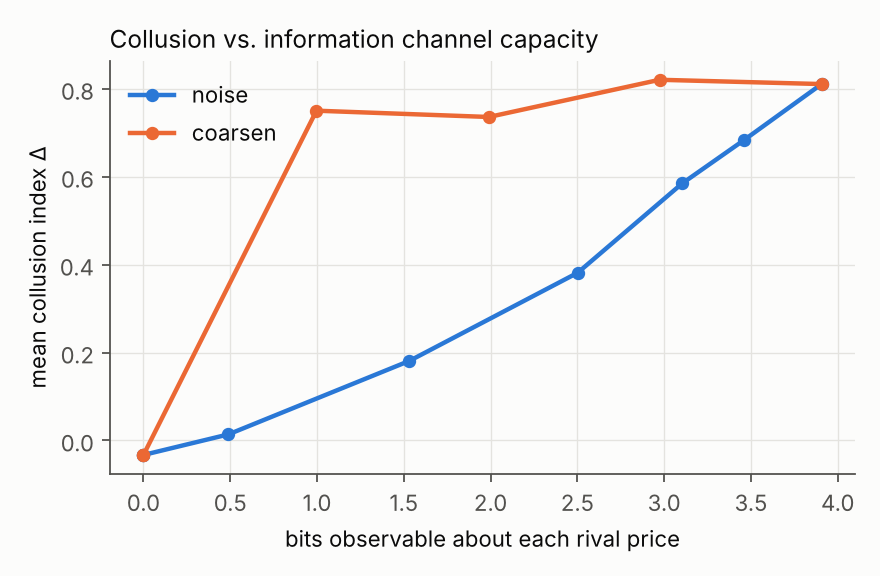
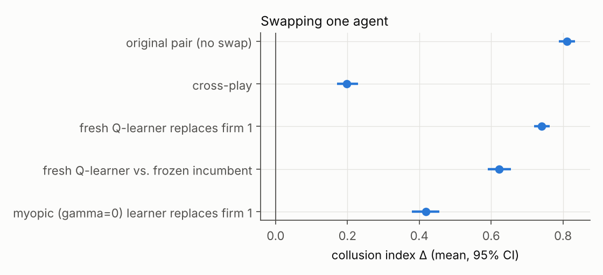
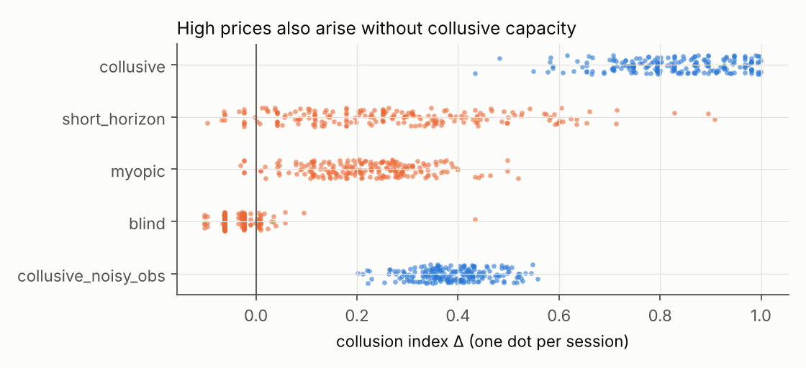

# Cheap Levers, Real Tests: Breaking and Auditing Algorithmic Collusion

*Apart Research AI Collusion Research Sprint, 23–25 October 2026. Tracks: Markets and Collusion (Q1.2, Q1.5) · Detection and Audit (Q2.3) · Carriers and Countermeasures (Q3.2).*

## Abstract

We revisit the repeated-pricing environment of Calvano et al. (2020). In it, independent Q-learning agents learn supracompetitive prices that are enforced by reward-and-punishment strategies. We ask three questions a regulator or platform would ask, and run about 3,600 learning sessions on a laptop-class CPU.

1. **Which single restriction removes the most collusion at the lowest cost?** Collusion travels on very little information. Collapsing what each agent sees of its rival's price to **one bit** (two buckets) leaves the collusion index almost unchanged (Δ 0.81 → 0.75). Random observation noise works far better: withholding the same ~1.4 bits as noise halves collusion (Δ 0.38 at ε = 0.2). A **one-period observation delay** cuts Δ by 41% while destroying no information at all, and mandated 5% price jitter cuts it by 44%. Only full rival-blindness, or noise at ε ≥ 0.7, returns prices to the competitive benchmark.
2. **Does collusion survive swapping a participant?** Not as a fixed policy. Pairing agents from different sessions collapses Δ from 0.81 to 0.20 and removes all punishment, so each pair's collusion is a private convention. It is, however, re-learned: a fresh learner entering against a still-learning incumbent reaches Δ = 0.74 within one training run.
3. **How can an auditor tell collusion from coincidence?** Agents that *cannot* sustain collusion still often reach high prices. Myopic (γ = 0) agents reach Δ > 0.2 in 56% of sessions. When we compare colluders with myopic agents at **matched price levels**, price level is useless (AUC 0.48). Parallel pricing is *anti*-diagnostic (AUC 0.02): the non-colluders move more in lockstep. A passive lead–lag test on a market with residual price noise is the best detector (AUC 0.90). A one-shot active deviation probe is informative but weaker (AUC 0.63).

The code includes a Claude-based LLM-agent harness for the same market, interventions and probe. We did not run it during the sprint because no API key was available.


*Figure 1. Overview. (A) Collusion left under each rule; (B) after swapping a bot; (C) how well each kind of evidence identifies collusion when colluders and non-colluders charge the same prices.*

## 1. Introduction

Pricing algorithms can learn to collude without communicating and without being designed to (Calvano et al., 2020; Klein, 2021). LLM agents do the same in simple oligopolies (Fish et al., 2024). Collusion detection also extends to messages between agents (Motwani et al., 2024; *Audit the Whisper*, 2025). The sprint asks when collusion emerges, how it is carried, how an auditor can tell it from coincidence, and how a defender can break it.

We pick a setting where every one of these quantities is measurable and the ground truth is known by construction, and we run all four questions on it:

* **Carrier.** Here the carrier is purely the *price signal*: there is no text channel. That lets us measure how much of the signal collusion actually needs (Q3.1, Q3.2).
* **Countermeasures.** Each intervention changes only what agents observe or do, has a dose, and has a cost, so they can be compared on one axis (Q1.5).
* **Ground truth for auditing.** We control whether agents *can* collude, by varying discounting and observability, independently of the prices they end up at. This gives labelled "coincidental high prices" to test detectors against (Q2.3).

## 2. Methods

**Market.** Logit-demand Bertrand oligopoly with Calvano et al.'s parameters: n = 2, quality a = 2, outside good a₀ = 0, cost c = 1, differentiation μ = 0.25. Static Nash price p_N = 1.473, joint-monopoly price p_M = 1.925, and a 15-point grid spanning [p_N − 0.1(p_M − p_N), p_M + 0.1(p_M − p_N)]. Collusion index Δ = (π̄ − π_N)/(π_M − π_N), where 0 is competitive and 1 is monopoly. We also report consumer surplus and total welfare.

**Agents.** Tabular Q-learning with one-period memory: the state is last period's observed price profile. Parameters: α = 0.15, γ = 0.95, exploration ε_t = exp(−βt) with β = 10⁻⁵, and Calvano initialisation. A session stops when every agent's greedy policy has been unchanged for 10⁵ periods, or at 3·10⁶ periods. Outcomes are averaged over greedy play after training. Every condition uses 100 independent seeds; the detection study uses 200. Kernels are JIT-compiled with numba, and one session takes about 0.3 s on one CPU core.

**Interventions.** Each acts on the information channel or the action channel during training *and* deployment:

| Lever | Dose | What it removes |
|---|---|---|
| Observation noise | ε ∈ {.05, .1, .2, .4, .7, 1} | each observed rival price is replaced by a uniform random grid price with probability ε |
| Coarsening | 8, 4, 2, 1 buckets | rival price is observed only up to a bucket |
| Delay | 1, 2, 4, 8 periods | rival price is observed late |
| Mandated jitter | p ∈ {.02, .05, .1, .2} | each executed price is randomised with probability p |
| Blindness | – | rival price is never observed |
| Entry | 3 firms | (structural benchmark) |

For noise and coarsening we report the information each agent can still extract about a rival price, I(true; observed) under a uniform prior. This is log₂ 15 ≈ 3.9 bits at baseline.

**Swaps (Q1.2).** From 100 converged baseline sessions we form five conditions: (i) the original pair; (ii) *cross-play*, where firm 0 from session s meets firm 1 from session s+1 with no relearning; (iii) a fresh Q-learner replaces firm 1 and both keep learning; (iv) a fresh learner faces a frozen incumbent; (v) a myopic (γ = 0) learner replaces firm 1.

**Detection (Q2.3).** Positives are γ = 0.95 agents with full observation (*collusive*) or with ε = 0.2 noise (*collusive_noisy_obs*). Negatives are agents that cannot run a punishment scheme: myopic (γ = 0), short-horizon (γ = 0.5) and rival-blind. Each detector is computed per session:

* **D1** price level Δ: the "high prices" heuristic.
* **D2** contemporaneous price correlation: "parallel conduct".
* **D3** passive lead–lag: corr(Δp_i(t), Δp_j(t+1)) over 20,000 periods of play in which each firm's price is randomised with probability 0.05 (natural price noise).
* **D4** active probe, punishment: firm 0 is forced to its static best response for one period, and we measure the rival's next-period price change relative to an identical-seed counterfactual (Calvano's impulse response).
* **D5** active probe, profitability: the discounted gain from that deviation. Collusion means the deviation does not pay.

We report ROC AUC with 1,000-sample bootstrap CIs. Most importantly, we add a **Δ-matched** comparison: each myopic session with Δ > 0.1 is matched to a γ = 0.95 session within 0.02 in Δ (60 pairs, mean gap 0.004). This asks whether a detector sees the *mechanism* rather than the price level.

## 3. Results

Full tables are in [`results/summary.md`](../results/summary.md).

### 3.1 Baselines

Two Q-learners reach Δ = 0.81 [0.79, 0.83] (99% of sessions above 0.5). A forced deviation is punished: the rival cuts its price by 0.41 (p_M − p_N) the next period, and the deviation loses 1.34 (π_M − π_N) in discounted terms. This replicates Calvano et al. A third firm lowers collusion to Δ = 0.63 but does not remove it.

### 3.2 Which lever? (Q1.5, Q3.2)




| Lever (dose) | Δ | change vs. baseline | bits removed | ΔCS | Δwelfare |
|---|---|---|---|---|---|
| baseline | 0.81 | – | 0 | – | – |
| coarsen to 2 buckets | 0.75 | −8% | 2.9 | +0.03 | +0.02 |
| noise ε = 0.2 | 0.38 | −53% | 1.4 | +0.15 | +0.05 |
| **delay 1 period** | **0.48** | **−41%** | **0** | +0.12 | +0.04 |
| jitter p = 0.05 | 0.45 | −44% | 0 (actions noised) | +0.12 | +0.04 |
| delay 2 periods | 0.31 | −62% | 0 | +0.18 | +0.06 |
| noise ε = 0.7 | 0.01 | −98% | 3.4 | +0.26 | +0.08 |
| blind | −0.03 | −104% | 3.9 | +0.27 | +0.08 |

Four findings:

1. **Collusion needs about one bit.** With only "is my rival's price high or low?" available, agents still sustain Δ = 0.75 with full punishment (−0.43). Measures that merely reduce the *precision* of price information, such as rounding or price bands, will not break this kind of collusion.
2. **The structure of the information removed matters more than the amount.** Noise and coarsening removing similar numbers of bits have very different effects: at about 1 bit retained, coarsening gives Δ = 0.75 while noise at about 1.5 bits retained gives 0.18. Random corruption makes a punishment trigger fire on innocent rivals, which unravels the scheme. Deterministic rounding does not.
3. **Delay is the cheapest information lever.** One period of staleness destroys no information but cuts Δ by 41%, and two periods cut it by 62%. Punishment still occurs (deviation gain stays negative), but it arrives too late to support high prices.
4. **No moderate dose reaches competitive pricing.** Delay and jitter plateau around Δ ≈ 0.2. Only blindness, or noise at ε ≥ 0.7, reaches the Nash benchmark. Every lever raises consumer surplus *and* total welfare in this market, because prices above cost are the only inefficiency. The "cost" of a lever is therefore mostly practical: how intrusive it is, and whether it degrades legitimate uses of price information. Total welfare never fell below baseline.

### 3.3 Swapping agents (Q1.2)



* **Cross-play destroys collusion.** Δ falls from 0.81 to 0.20, only 4% of mixed pairs exceed 0.5, and punishment disappears (−0.004). Each pair learns its own private convention of prices and triggers, and these are mutually unintelligible across sessions. For a defender, simply rotating which algorithm faces which rival breaks the learned equilibrium, at least until it is re-learned.
* **But collusion is quickly re-learned.** A fresh learner against a still-learning incumbent reaches Δ = 0.74 with punishment intact.
* **A frozen incumbent produces high prices without enforcement.** A fresh learner facing a frozen incumbent reaches Δ = 0.62, but the incumbent's deviation would now *pay* (+1.54). The entrant has learned to accommodate the incumbent, not to punish it. This is a high-price outcome with no reward-punishment scheme behind it, the kind of case an auditor must not confuse with collusion.
* **A myopic entrant halves collusion** (Δ = 0.42).

### 3.4 Telling collusion from coincidence (Q2.3)



Agents that cannot collude often still price high: myopic agents average Δ = 0.22 and short-horizon agents 0.27, with upper tails reaching the colluders' range. Pooled over all controls, the price level alone separates the classes well (AUC 0.99). That is because the *clean* colluders price far higher than anything else, not because price level reveals the mechanism. Once colluders are noisier (ε = 0.2, Δ ≈ 0.39), every detector degrades.


| Scenario | D1 level | D2 parallel | D3 lead–lag | D4 punish | D5 dev. unprofitable |
|---|---|---|---|---|---|
| all controls | 0.99 | 0.75 | 0.62 | 0.82 | 0.89 |
| high prices only (Δ > 0.2) | 0.99 | 0.60 | 0.65 | 0.77 | 0.88 |
| noisy colluders vs. all controls | 0.88 | 0.37 | 0.70 | 0.73 | 0.65 |
| **Δ-matched vs. myopic (60 pairs)** | **0.48** | **0.02** | **0.90** | **0.63** | **0.63** |

At equal price levels:

* **Price level carries no information** (0.48), by construction of the matching.
* **Parallel pricing points the wrong way** (0.02). Myopic agents have *higher* contemporaneous price correlation than colluders at the same Δ. "Conscious parallelism" is not just weak evidence here; it is evidence in the wrong direction.
* **Reaction structure is the signal.** The passive lead–lag test is the best detector (0.90). It needs residual randomness in prices (here 5% price noise), which acts as thousands of small natural experiments. Without that noise, a converged market is static and passive tests have nothing to work with.
* **A single forced deviation is weaker than expected** (0.63). Matched colluders are mostly the noisy-observation agents, whose noisy view of their rival mutes the reaction to a single one-period move. D5 (profitability) also correctly flags punishment that arrives *late*: under observation delay, D4's next-period response is exactly 0, but the deviation still loses money (−2.23 at one period of delay). Audits should therefore score the *payoff consequence* of a deviation over a window, not the immediate price response.

**What should count as evidence?** A convincing case needs (a) supracompetitive prices, plus (b) evidence that a firm's prices *respond* to rival price cuts in a way that makes those cuts unprofitable. Parallel price movements and high levels, the usual observable "plus factors", do not separate collusion from coincidence when price levels are comparable.

### 3.5 LLM agents: protocol and pre-registered predictions (not yet run)

`experiments/run_llm.py` runs Claude pricing agents (after Fish et al., 2024) in the same market. There are four conditions × 5 seeds × 100 periods, and firm 0 is forced to its static best response at period 80:

| Condition | What the agents see |
|---|---|
| `full` | full price history (baseline) |
| `noisy` | rival prices replaced by random values 30% of the time |
| `own` | no rival prices (blind) |
| `comm` | full history plus a free-text message channel between firms (an overt carrier) |

`experiments/analyze_llm.py` computes the same metrics as the Q-learning study (Δ, punishment, deviation gain, parallel pricing, lead–lag). It also flags messages containing coordination language. The pipeline was verified end-to-end with a scripted trigger-strategy bot (`--backend fake`); those outputs are pipeline tests, not results.

We record our predictions here **before** running, so the LLM study can confirm or refute them:

1. **P1:** `full` reaches Δ > 0.3. Supracompetitive pricing appears without instructions to collude, as in Fish et al.
2. **P2:** `own` (blind) gives a clearly lower Δ than `full`, mirroring the Q-learning result that rival information is the carrier.
3. **P3:** `noisy` lies between `own` and `full`.
4. **P4:** `comm` gives a higher Δ than `full`, and some messages contain explicit coordination language detectable by a keyword auditor.
5. **P5:** In `full`, the forced deviation is followed by a rival price cut (punishment < 0), unlike `own`.

## 4. Discussion and limitations

* **Toy market, tabular agents.** The findings are for Q-learning with one-period memory, 15 prices and symmetric firms. Deep-RL or LLM agents with longer memory may need more than one bit, or may route around delay by conditioning on longer histories.
* **Convergence under noise.** With observation noise or jitter, many sessions never reach the strict convergence criterion: 0% for jitter and 50–94% for noise. Those sessions are evaluated after 3·10⁶ periods with exploration fully decayed. Their Δ is the outcome of continuing play, not of a fixed point.
* **Labels are about capacity.** "Collusive" means agents that *can* run a punishment scheme. The short-horizon (γ = 0.5) control can partially punish (−0.13), so it is an imperfect negative. We report the myopic-only comparisons separately for that reason.
* **The best detector assumes randomness.** The lead–lag detector relies on 5% random price noise at audit time. In practice an auditor could induce this, for example with a sandboxed replay or mandated A/B price experimentation. The active probe needs the ability to act in the market, or a faithful simulator.
* **No LLM results yet.** The LLM study (Section 3.5) is fully implemented and pipeline-tested, but it has not been run because no API key was available during the sprint.

### Ethics and dual use

Everything here concerns *detecting and disrupting* collusion. The dual-use risk is that the same results describe what a colluding system could do to evade oversight. For example, it could keep its coordination signal coarse (it survives rounding), or keep its prices deterministic (that starves passive lead–lag audits of the variation they need). We judge this risk to be low: these properties are already known from the algorithmic-pricing literature, the agents are toy tabular learners, and the main practical implication favours auditors. Regulators can *induce* the price variation that makes reaction structure observable, instead of relying on price levels or parallelism. We release no tooling aimed at real markets.

## 5. Conclusion

For learned tacit collusion in this standard market, the price signal is the carrier, and it needs about one bit. Defenders should **corrupt or delay** the signal rather than round it. They can also **rotate counterparties**, since learned conventions do not transfer, though that only buys time until the convention is re-learned. Auditors should look for **responses that make price cuts unprofitable**, not for high or parallel prices, which coincidental high pricing reproduces and parallel movement can even invert.

## References

* Calvano, E., Calzolari, G., Denicolò, V., & Pastorello, S. (2020). Artificial Intelligence, Algorithmic Pricing, and Collusion. *American Economic Review* 110(10).
* Fish, S., Gonczarowski, Y., & Shorrer, R. (2024). Algorithmic Collusion by Large Language Models. arXiv:2404.00806.
* Klein, T. (2021). Autonomous algorithmic collusion: Q-learning under sequential pricing. *RAND Journal of Economics* 52(3).
* Motwani, S. et al. (2024). Secret Collusion among AI Agents: Multi-Agent Deception via Steganography. arXiv:2402.07510.
* Audit the Whisper: Detecting Steganographic Collusion in Multi-Agent LLMs (2025). arXiv:2510.04303.
* On the Fragility of AI Agent Collusion (2026). arXiv:2603.20281.
* Evaluating LLM Agent Collusion in Double Auctions (2025). arXiv:2507.01413.
* Hammond, L. et al. (2025). Multi-Agent Risks from Advanced AI. arXiv:2502.14143.

## Appendix: reproducibility

```
pip install -r requirements.txt
python -m experiments.run_all     # about 3,600 learning sessions; about 15 min on 4 cores
python -m experiments.analyze     # results/summary.md + results/figures/

# LLM study (needs ANTHROPIC_API_KEY)
python -m experiments.run_llm     # 4 conditions x 5 seeds x 100 periods = 4,000 model calls; resumable
python -m experiments.analyze_llm # results/llm_summary.md + results/figures/llm_paths.png
```

All randomness is seeded. A session with a given configuration and seed is deterministic (tested in `tests/test_core.py`).
