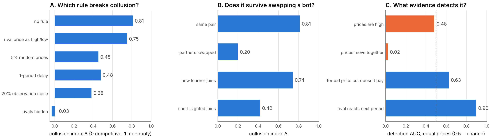
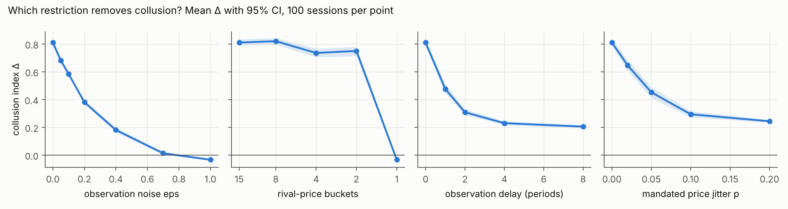
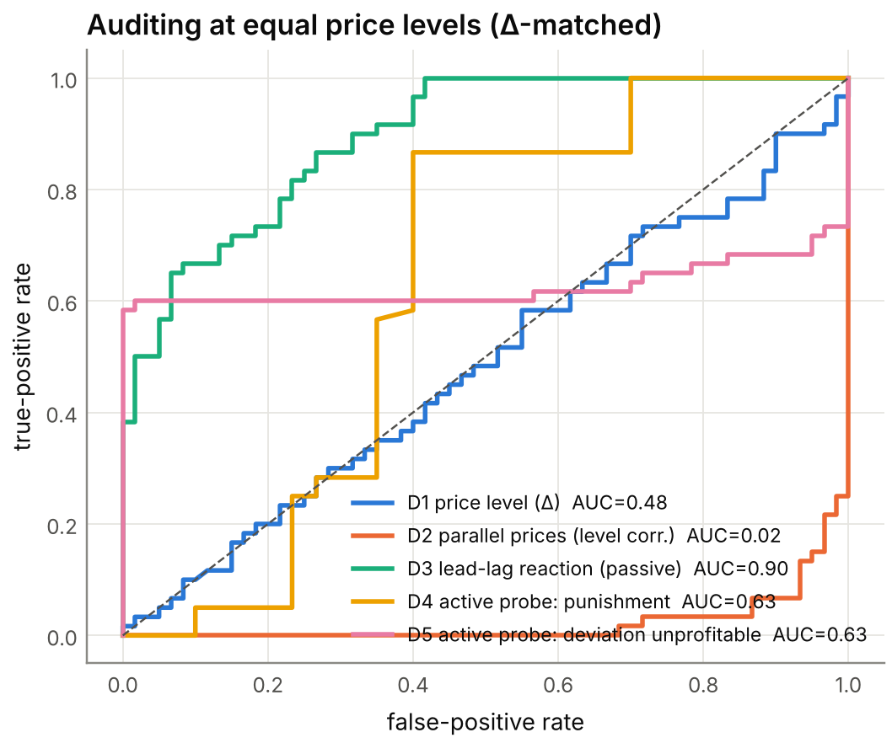

**manuaishika** — [Affiliation]

*With Apart Research*

## Abstract

AI pricing agents can learn to collude without communicating: in repeated markets, independent learners settle on high prices and punish rivals who undercut. Regulators and platforms need to know two things: which restrictions break such collusion, and what evidence distinguishes it from prices that are merely high by coincidence. We study both in the standard logit-demand pricing game of Calvano et al. (2020). We run about 3,600 learning sessions in which Q-learning agents are trained under five interventions on what they observe or do, and against controls that reach high prices but cannot sustain collusion.

Three results stand out:

1. **Collusion needs about one bit.** Showing agents only whether a rival's price is "high or low" leaves collusion almost intact (collusion index 0.81 → 0.75). Random observation noise and a one-period observation delay cut it substantially (0.38 and 0.48), and delay does so without removing any information.
2. **Collusion is a private convention.** Agents from different sessions fail to collude with each other (0.20), but a newly entering learner re-learns collusion with the incumbent (0.74).
3. **Standard evidence fails.** When colluders and non-colluders charge equal prices, price level is uninformative (AUC 0.48) and parallel pricing points the wrong way (AUC 0.02). Whether a firm reacts to its rival's price changes the next period detects collusion well (AUC 0.90).

The takeaway: defenders should corrupt or delay the price signal rather than coarsen it, and auditors should test reactions, not price levels or parallelism.

## 1. Introduction

Firms increasingly delegate pricing to algorithms, and soon to LLM-based agents. A growing literature shows that reinforcement-learning agents can learn supracompetitive prices sustained by reward-and-punishment strategies, without being instructed to collude and without communicating (Calvano et al., 2020; Klein, 2021). LLM agents do the same in simple oligopolies (Fish et al., 2024). This is a concrete multi-agent failure mode: agents optimising for their principals jointly harm third parties, here consumers (Hammond et al., 2025). It is hard to police, because competition law targets *agreements*, and there is none (Harrington, 2018).

Two practical questions follow:

- A **defender**, such as a regulator, a platform or an agent developer, wants the cheapest restriction that stops collusion.
- An **auditor** must decide whether high prices reflect collusion or coincidence. Agents can reach high prices for benign reasons, such as incomplete learning, and the observable "plus factors" used in antitrust, notably parallel pricing, may not separate the cases.

We answer both in a setting where the ground truth is known by construction: we control whether agents *can* run a punishment scheme, independently of the prices they reach.

Our main contributions are:

1. **A dose–response map of five interventions** on the price signal and on executed prices: noise, coarsening, delay, mandated price jitter and blindness. Their costs are expressed in bits of information withheld and in welfare. Collusion survives coarsening to one bit but not noise or delay.
2. **Evidence that learned collusion is a pair-specific convention.** Cross-play between independently trained agents removes it, yet it is re-learned after entry.
3. **A labelled benchmark for telling collusion from coincidence.** On it, price levels and parallel pricing fail at matched price levels, while a reaction-based test succeeds. We also provide a pipeline-tested LLM-agent harness with the same interventions and probe, together with pre-registered predictions for it.

## 2. Related Work

**Algorithmic collusion.** Calvano et al. (2020) show that Q-learning agents in a repeated logit-demand Bertrand game learn prices near monopoly levels, enforced by punishments. They verify this with an impulse-response test, which we reuse as an active probe. Klein (2021) finds similar results with sequential pricing. Asker, Fershtman and Pakes (2022) show that outcomes depend on algorithm design, for instance whether agents learn from counterfactual prices. Fish et al. (2024) find that LLM pricing agents also reach supracompetitive prices.

**Remedies.** Johnson, Rhodes and Wildenbeest (2023) study platform design rules that steer demand to discipline pricing algorithms. Abada and Lambin (2023) argue that seemingly collusive outcomes can arise from imperfect exploration, not collusion. That motivates our coincidence controls. We differ from both in comparing *information-channel* interventions on a common scale, bits withheld, with matched welfare accounting.

**Detection and collusion carriers.** Work on LLM collusion focuses on explicit or steganographic messages and auditors that inspect them (Motwani et al., 2024; *Audit the Whisper*, 2025). We study the complementary case in which the carrier is the price signal itself and there is no text to inspect. We ask what *behavioural* evidence an auditor can rely on. To our knowledge, no prior work compares passive and active behavioural detectors against labelled non-collusive agents at matched price levels.

## 3. Methods

**Market.** We use the logit-demand Bertrand game of Calvano et al. (2020) with their parameters: 2 firms, quality *a* = 2, outside good *a*₀ = 0, cost *c* = 1, differentiation μ = 0.25. The static Nash price is p_N = 1.473 and the joint-monopoly price is p_M = 1.925. Prices lie on a 15-point grid spanning [p_N − 0.1Δp, p_M + 0.1Δp]. The **collusion index** is Δ = (π̄ − π_N)/(π_M − π_N), so 0 is competitive and 1 is monopoly. We also report consumer surplus and total welfare.

**Agents.** Tabular Q-learning with one-period memory: the state is the price profile observed last period. Learning rate α = 0.15, discount γ = 0.95, exploration ε_t = e^(−βt) with β = 10⁻⁵, and Q-values initialised as in Calvano et al. Training stops once greedy policies are unchanged for 10⁵ periods, or at 3×10⁶ periods. Outcomes are measured over 400 periods of greedy play after training, or 4,900 under noise or jitter, where play is stochastic. We use β = 10⁻⁵ rather than Calvano's 4×10⁻⁶ to make convergence about 2.5× faster. Our baseline still reproduces their result (Section 4.1). Kernels are compiled with numba, so a session takes about 0.3 s on one CPU core.

**Interventions** apply during training and deployment:

- *noise*: each observed rival price is replaced by a random grid price with probability ε;
- *coarsening*: the rival's price is observed only up to k buckets;
- *delay*: the rival's price is observed d periods late;
- *jitter*: each executed price is randomised with probability p;
- *blind*: the rival's price is never observed.

For noise and coarsening we compute the mutual information I(true; observed) under a uniform prior. It is log₂15 ≈ 3.9 bits at baseline. Each condition is run with 100 seeds.

**Swaps.** From 100 converged baseline pairs we form: (i) *cross-play*, where firm 0 from session s meets firm 1 from session s+1 with no further learning; (ii) a fresh learner replaces firm 1 and both continue learning; (iii) a fresh learner faces a frozen incumbent; (iv) a myopic (γ = 0) learner replaces firm 1.

**Detection benchmark.**

- *Positives* (200 seeds each): γ = 0.95 agents, which can run punishment schemes, with full observation or with ε = 0.2 noise.
- *Negatives* (200 seeds each): agents that cannot, namely myopic (γ = 0), short-horizon (γ = 0.5) and rival-blind agents.

We score five detectors per session:

- **D1**, price level Δ.
- **D2**, correlation of the two firms' prices ("parallel conduct").
- **D3**, lead–lag reaction: corr(Δp_i(t), Δp_j(t+1)), computed over 20,000 periods in which each price is randomised with probability 0.05.
- **D4**, the active probe's punishment: firm 0 is forced to its static best response for one period, and we measure the rival's next-period price change against an identical-seed counterfactual.
- **D5**, the probe's profitability: the discounted gain from that deviation.

We report ROC AUC with 1,000-sample bootstrap CIs. The key comparison is **Δ-matched**: each myopic session with Δ > 0.1 is paired with a γ = 0.95 session within 0.02 in Δ, giving 60 pairs with a mean gap of 0.004. A detector can then only succeed by seeing the *mechanism*, not the price level.

**What didn't work.** Our first matching used nearest neighbours without a caliper. Because the two classes' Δ distributions overlap only partly, it left a 0.13 mean Δ gap, and price level still looked diagnostic (AUC 0.89). The caliper fixes this.

## 4. Results

*Figure 1. Overview. (A) Mean collusion index Δ under one representative dose of each intervention, 100 sessions each. (B) Δ after swapping one agent. (C) Detection AUC when colluding and non-colluding agents charge the same prices (Δ-matched, 60 pairs); 0.5 is chance, and orange marks detectors at or below chance.*

### 4.1 Baseline

Two Q-learners reach Δ = 0.81 (95% CI 0.79–0.83), with 99% of sessions above 0.5. A forced deviation is punished: the rival cuts its price by 0.41(p_M − p_N) the next period, and the deviation loses 1.34(π_M − π_N) in discounted profit. This reproduces Calvano et al. (2020). A third firm reduces Δ to 0.63.

### 4.2 Which restriction breaks collusion? (Q1.5, Q3.2)

*Table 1. Collusion under each intervention. Mean Δ over 100 sessions (95% bootstrap CI); bits removed relative to 3.9 bits; changes in consumer surplus (CS) and total welfare (W) relative to baseline.*

| Intervention (dose) | Δ (95% CI) | Bits removed | ΔCS | ΔW |
|---|---|---|---|---|
| none | 0.81 (0.79–0.83) | 0 | – | – |
| coarsen to 2 buckets | 0.75 (0.71–0.78) | 2.9 | +0.03 | +0.02 |
| jitter p = 0.05 | 0.45 (0.41–0.49) | 0 | +0.12 | +0.04 |
| delay 1 period | 0.48 (0.45–0.51) | 0 | +0.12 | +0.04 |
| noise ε = 0.2 | 0.38 (0.37–0.40) | 1.4 | +0.15 | +0.05 |
| delay 2 periods | 0.31 (0.29–0.33) | 0 | +0.18 | +0.06 |
| noise ε = 0.7 | 0.01 (0.00–0.03) | 3.4 | +0.26 | +0.08 |
| blind | −0.03 (−0.04 to −0.02) | 3.9 | +0.27 | +0.08 |

*Figure 2. Dose–response for four interventions (mean Δ with 95% CI, 100 sessions per point). Coarsening has almost no effect until the rival price is removed entirely (1 bucket). Noise reduces collusion steadily. Delay and jitter level off near Δ ≈ 0.2.*

**Observations.**

- *Coarsening:* with only a high/low signal (1 bit), agents still sustain Δ = 0.75, with full punishment (−0.43).
- *Noise:* the same number of bits withheld as noise cuts collusion far more. At ε = 0.4, with 1.5 bits retained, Δ = 0.18.
- *Delay:* one period of delay removes no information but cuts Δ by 41%. Punishment still occurs (the deviation gain stays negative), just too late.
- *Plateau:* delay and jitter level off near Δ ≈ 0.2. Only blindness or ε ≥ 0.7 restores competitive prices.
- *Welfare:* every intervention raised both consumer surplus and total welfare relative to baseline.

**Interpretation.** A trigger strategy needs only to detect "rival cut its price". Rounding preserves that event; random corruption makes triggers fire on innocent rivals and unravels the scheme.

**Robustness.** The CIs are narrow (100 seeds), and the effects are monotone in dose for noise, delay and jitter. Under noise and jitter, however, many sessions never meet the strict convergence criterion (Section 5).

### 4.3 Does collusion survive swapping an agent? (Q1.2)

Cross-play between independently trained agents collapses Δ to 0.20 (0.17–0.23). Only 4% of mixed pairs exceed 0.5, and punishment vanishes (−0.004). The collusion is real but *pair-specific*: each pair settles on its own prices and triggers. It is quickly re-established, though. A fresh learner paired with a still-learning incumbent reaches Δ = 0.74 (0.72–0.76), and a myopic entrant gives 0.42.

Against a frozen incumbent, the entrant reaches Δ = 0.62, but deviating against it now *pays* (+1.54). The entrant has learned to accommodate the incumbent rather than to punish it. This is another high-price outcome without collusion.

### 4.4 Telling collusion from coincidence (Q2.3)

Agents that cannot collude still often price high: 56% of myopic sessions have Δ > 0.2, and some reach 0.5. Pooled over all controls, price level separates the classes almost perfectly (AUC 0.99), but only because fully observing colluders price far above everything else. Against noisy-observation colluders (Δ ≈ 0.39), every detector degrades (Table 2).

*Table 2. ROC AUC (95% bootstrap CI) of five detectors. Positives: γ = 0.95 agents; negatives: myopic, short-horizon and blind agents. The bottom row compares 60 caliper-matched pairs with equal price levels.*

| Scenario | D1 level | D2 parallel | D3 lead–lag | D4 punish | D5 dev. unprofitable |
|---|---|---|---|---|---|
| All controls | 0.99 | 0.75 | 0.62 | 0.82 | 0.89 |
| Noisy colluders vs. all controls | 0.88 | 0.37 | 0.70 | 0.73 | 0.65 |
| **Δ-matched vs. myopic** | **0.48** (0.38–0.59) | **0.02** (0.01–0.05) | **0.90** (0.84–0.94) | **0.63** (0.53–0.73) | **0.63** (0.51–0.74) |

*Figure 3. ROC curves at matched price levels. The dashed line is chance. "Prices move together" (D2) lies far below chance: non-colluding agents move their prices in lockstep more than colluders do.*

**At equal price levels:**

- *Price level* (D1) is at chance, by construction of the matching.
- *Parallel pricing* (D2) is strongly anti-diagnostic: myopic agents are *more* correlated than colluders.
- *The passive lead–lag test* (D3) is best. It relies on residual price randomness, which supplies many small natural experiments.
- *The single-shot active probe* (D4, D5) is informative but weaker. The matched colluders are mostly noisy-observation agents, whose reaction to a one-period move is muted.

Under observation delay, D4 reads exactly 0 because punishment arrives late, while D5 still detects that the deviation does not pay (−2.23 at one period of delay). Audits should therefore score the payoff consequences of a deviation over a window, not the immediate reaction.

## 5. Discussion and Limitations

**Implications for AI safety.** As pricing and negotiation are delegated to AI agents, harmful coordination can emerge without intent or messages. Our results give three practical rules:

1. *Coordination channels can be extremely narrow.* Limiting the precision of shared information is not a safeguard; randomising or delaying it is.
2. *Learned conventions are brittle across partners but re-learnable.* Rotating counterparties disrupts collusion only temporarily.
3. *Behavioural audits must test reactions.* Price levels and parallelism, the observable evidence typically used, fail or even mislead once coincidental high prices are possible. Because the best passive detector needs price variation, a regulator can *induce* that variation, for example through mandated price experimentation or sandboxed replays, rather than wait for it.

**Limitations.**

- *Simple agents.* We use tabular Q-learners with one-period memory, 15 prices and two symmetric firms. Agents with longer memory might route around a one-period delay or need more than one bit.
- *Convergence.* Under noise and jitter, many sessions do not meet the strict convergence criterion: 0% for jitter and 50–94% for noise. Those sessions are evaluated after 3×10⁶ periods with exploration decayed, so their Δ reflects continued play rather than a fixed point.
- *What "collusive" means.* Labels encode *capacity* to collude. Short-horizon agents (γ = 0.5) can partially punish (−0.13), so they are imperfect negatives; the headline comparison therefore uses myopic agents only.
- *Sample size.* The matched sample is small (60 pairs), and its CIs are correspondingly wide.
- *Welfare cost.* Welfare effects are specific to this market, where high prices are the only inefficiency. In markets where price information has legitimate value, noise and delay would carry real costs.
- *Untested carriers.* We do not study text or steganographic channels.

**Future work.**

- *LLM agents.* Run the LLM study in the appendix and test whether its pre-registered predictions hold.
- *Richer learners.* Test deep-RL and LLM agents with longer memory against delay and coarsening.
- *Calibrated audits.* Combine reaction-based behavioural audits with message auditing in settings where both channels exist.

**Ethics and dual use.** These results could inform evasion: a colluding system could keep its signal coarse, or keep its prices deterministic to starve passive audits. We consider the risk low. The properties are known from prior literature, the agents are toy learners, and the main implication, that regulators can induce informative price variation, favours auditors. We release no tooling aimed at real markets.

## 6. Conclusion

In a standard repeated pricing game, learned tacit collusion travels on the price signal and needs about one bit of it. Coarsening that signal does almost nothing. Randomly corrupting it or delaying it by a single period cuts collusion by 40–60%, and only removing it entirely restores competition. Collusion is a private convention between the agents that learned it: it disappears when partners are swapped and reappears when a new learner enters.

For auditors, high and parallel prices are poor evidence. At equal price levels, the first is uninformative and the second points the wrong way. Testing whether firms *react* to rivals' price changes in a way that makes undercutting unprofitable separates collusion from coincidence. Defenders of multi-agent AI systems should accordingly target the reliability and timeliness of coordination signals, and auditors should measure reactions rather than outcomes.

## Code and Data

- **Code repository:** https://github.com/manuaishika/ai-sprint-apart. It covers the market, agents and interventions, the experiment and analysis scripts, tests, and the LLM-agent harness.
- **Data:** all session-level results are in `results/*.csv`, with summary tables in `results/summary.md`. To regenerate everything: `python -m experiments.run_all && python -m experiments.analyze`. This takes about 15 minutes on 4 CPU cores and needs no GPU or API key.
- **Info-hazard note:** see *Ethics and dual use* above.

## Author Contributions

manuaishika directed the project and chose the research questions. Implementation, experiments and drafting were done with Claude Code (Appendix C).

## References

- Abada, I., & Lambin, X. (2023). Artificial intelligence: Can seemingly collusive outcomes be avoided? *Management Science*, 69(9). https://doi.org/10.1287/mnsc.2022.4623
- Asker, J., Fershtman, C., & Pakes, A. (2022). Artificial intelligence, algorithm design, and pricing. *AEA Papers and Proceedings*, 112. https://doi.org/10.1257/pandp.20221059
- *Audit the Whisper: Detecting Steganographic Collusion in Multi-Agent LLMs* (2025). arXiv:2510.04303. https://arxiv.org/abs/2510.04303
- Calvano, E., Calzolari, G., Denicolò, V., & Pastorello, S. (2020). Artificial intelligence, algorithmic pricing, and collusion. *American Economic Review*, 110(10), 3267–3297. https://doi.org/10.1257/aer.20190623
- Fish, S., Gonczarowski, Y. A., & Shorrer, R. I. (2024). Algorithmic collusion by large language models. arXiv:2404.00806. https://arxiv.org/abs/2404.00806
- Hammond, L., et al. (2025). Multi-agent risks from advanced AI. arXiv:2502.14143. https://arxiv.org/abs/2502.14143
- Harrington, J. E. (2018). Developing competition law for collusion by autonomous artificial agents. *Journal of Competition Law & Economics*, 14(3), 331–363. https://doi.org/10.1093/joclec/nhy016
- Johnson, J. P., Rhodes, A., & Wildenbeest, M. (2023). Platform design when sellers use pricing algorithms. *Econometrica*, 91(5), 1841–1879. https://doi.org/10.3982/ECTA19978
- Klein, T. (2021). Autonomous algorithmic collusion: Q-learning under sequential pricing. *RAND Journal of Economics*, 52(3), 538–558. https://doi.org/10.1111/1756-2171.12383
- Motwani, S. R., et al. (2024). Secret collusion among AI agents: Multi-agent deception via steganography. arXiv:2402.07510. https://arxiv.org/abs/2402.07510

## Appendix

### A. Full intervention and swap results

*Table A1. All intervention doses (100 sessions each). "Converged" is the share of sessions meeting the stopping criterion. "Punish" is the rival's next-period price response to a forced deviation, in units of p_M − p_N. "Dev. gain" is the discounted gain from that deviation, in units of π_M − π_N; negative means the deviation does not pay.*

| Intervention | Dose | Δ | Converged | Punish | Dev. gain |
|---|---|---|---|---|---|
| baseline | – | 0.81 | 100% | −0.41 | −1.34 |
| entry | 3 firms | 0.63 | 100% | −0.28 | −2.98 |
| noise | ε = 0.05 / 0.1 / 0.2 / 0.4 / 0.7 / 1.0 | 0.68 / 0.58 / 0.38 / 0.18 / 0.01 / −0.03 | 66 / 59 / 50 / 77 / 91 / 94% | −0.32 / −0.27 / −0.11 / −0.04 / 0.00 / 0.00 | −0.77 / −0.55 / −0.16 / −0.05 / −0.01 / 0.00 |
| coarsen | 8 / 4 / 2 / 1 buckets | 0.82 / 0.74 / 0.75 / −0.03 | 100% | −0.47 / −0.34 / −0.43 / 0.00 | −1.62 / −1.56 / −1.34 / 0.01 |
| delay | 1 / 2 / 4 / 8 periods | 0.48 / 0.31 / 0.23 / 0.21 | 100% | 0.00 (punishment arrives later) | −2.23 / −1.47 / −0.60 / −0.35 |
| jitter | p = 0.02 / 0.05 / 0.1 / 0.2 | 0.65 / 0.45 / 0.29 / 0.24 | 0% | −0.38 / −0.22 / −0.11 / −0.04 | −1.02 / −0.50 / −0.14 / 0.01 |

*Table A2. Swapping one agent (100 sessions each).*

| Condition | Δ (95% CI) | Share Δ > 0.5 | Punish | Dev. gain |
|---|---|---|---|---|
| original pair | 0.81 (0.79–0.83) | 99% | −0.41 | −1.34 |
| cross-play, no relearning | 0.20 (0.17–0.23) | 4% | 0.00 | +0.04 |
| fresh learner, both learning | 0.74 (0.72–0.76) | 97% | −0.34 | −0.86 |
| fresh learner vs. frozen incumbent | 0.62 (0.59–0.65) | 77% | −0.10 | +1.54 |
| myopic (γ = 0) entrant | 0.42 (0.38–0.46) | 34% | −0.18 | −1.39 |

### B. LLM-agent study: protocol and pre-registered predictions (not yet run)

`experiments/run_llm.py` places Claude pricing agents (after Fish et al., 2024) in the same market.

- *Conditions* (4 × 5 seeds × 100 periods): `full` (full price history); `noisy` (each rival price replaced at random 30% of the time); `own` (no rival prices); `comm` (full history plus a free-text message channel between firms).
- *Probe:* firm 0 is forced to its static best response at period 80.
- *Analysis:* `experiments/analyze_llm.py` computes the same metrics as above and flags coordination language in messages.
- *Pipeline test:* the pipeline was tested end-to-end with scripted bots (`--backend fake`); those outputs are not results.
- *Status:* no API key was available during the sprint.

Predictions recorded before running:

- **P1.** `full` reaches Δ > 0.3.
- **P2.** `own` gives clearly lower Δ than `full`.
- **P3.** `noisy` lies between `own` and `full`.
- **P4.** `comm` gives higher Δ than `full`, and some messages contain explicit coordination language.
- **P5.** In `full`, the forced deviation is followed by a rival price cut, unlike in `own`.

### C. LLM usage statement

We used Claude (via Claude Code) extensively:

- to implement the simulation, experiment and analysis code;
- to run the experiments;
- to produce the figures;
- to draft this report.

All numbers in this report are generated by the code in the repository from the logged session results, and the code is covered by unit tests. The research questions and final editorial decisions are the author's.
